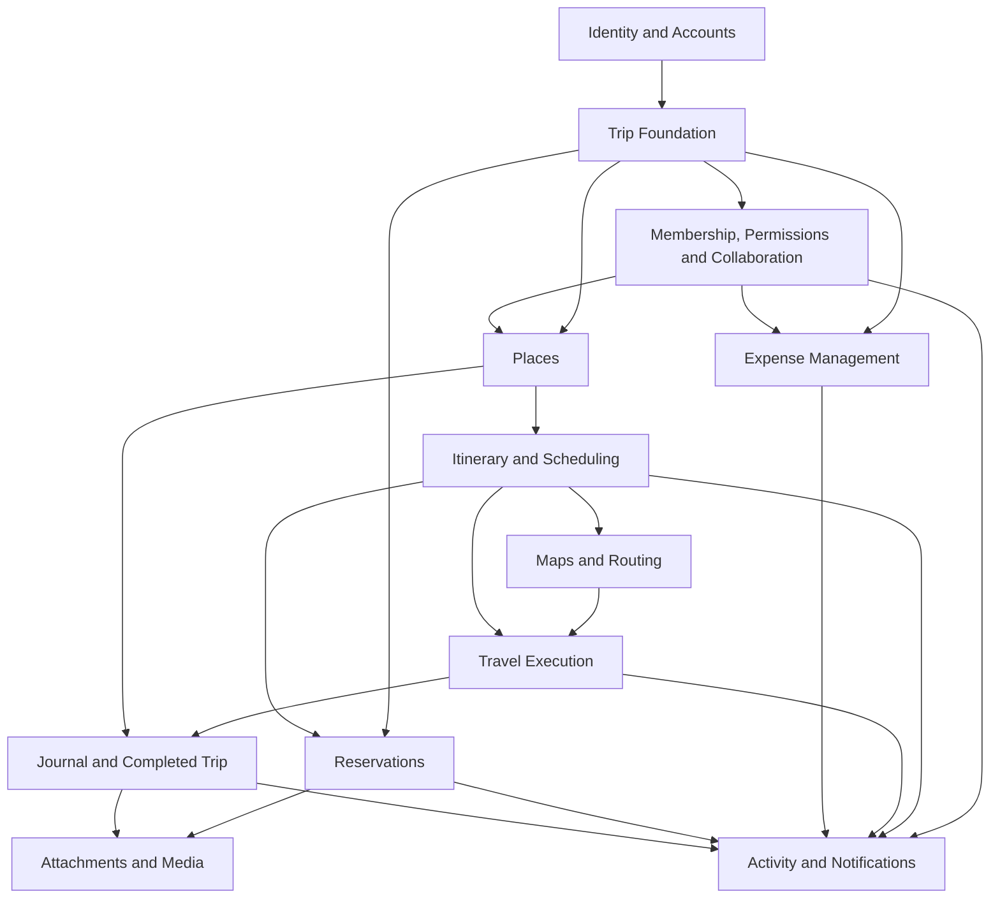

# Trip Planner — Product & Engineering Learning Roadmap

**Version:** 1.0  
**Purpose:** A structured learning and research plan to understand every major Trip Planner capability, reverse-engineer market solutions, design our own technical approach, and become ready to build modules with AI assistance.

> **Learning rule:** Do not start implementing the production product just because a feature is understood at UI level. First understand the user problem, existing market behaviour, domain rules, data lifecycle, technical options, dependencies, failure cases, and acceptance criteria.

---

# 1. How to Use This Roadmap

This is a learning roadmap, not a coding task list. Follow the phases in order because later capabilities depend on earlier concepts.

For every phase, use this learning loop:

1. **Understand the problem** — Describe the real-world difficulty in plain language.
2. **Observe the market** — Explore how Wanderlog and relevant specialist products solve it.
3. **Learn the concepts** — Study the product, domain, and engineering concepts required.
4. **Compare solutions** — Understand at least two viable technical approaches and their trade-offs.
5. **Design our approach** — Define behaviour, domain model, states, APIs, data ownership, and failure handling.
6. **Validate understanding** — Explain the design, walk through examples, and test edge cases on paper or with small isolated exercises.
7. **Record decisions** — Update the module specification and master architecture.

Do not use AI as an unquestioned answer generator. Ask it to explain assumptions, cite market evidence, compare alternatives, challenge your proposed design, and identify unknowns.

## Evidence labels

When researching existing products, label every claim:

- **Verified observation:** Directly observed in the product.
- **Officially documented:** Stated in official documentation.
- **Inference:** A plausible explanation based on observed behaviour.
- **Hypothesis:** Needs validation.
- **Unknown:** Not established.

We can reverse-engineer public behaviour and workflows. We cannot claim to know Wanderlog's private database schema, algorithms, services, or infrastructure without evidence.

## What each phase must produce

Every phase should result in a small set of artifacts:

- Problem statement and sub-problem map.
- Market behaviour notes with sources/screenshots where permitted.
- Functional workflow and business rules.
- Domain model and state transitions.
- Technical design alternatives and recommendation.
- API and data design draft.
- Dependency updates.
- Edge-case and test checklist.
- Open questions and architecture decisions.

---

# 2. Overall Learning Sequence

| Phase | Area | Why it comes here | Main outcome |
|---|---|---|---|
| 0 | Product and system foundations | Establish the language used in all later designs | Understand how to move from problem to domain to architecture |
| 1 | Identity and trip foundation | Every feature belongs to a user and a trip | Secure users, trips, memberships and ownership |
| 2 | Invitations, permissions and collaboration | A trip becomes a shared workspace | Multiple users safely work on shared trip data |
| 3 | Places and destination data | Itinerary items need a place/domain object | Manage places independently of schedules |
| 4 | Itinerary and scheduling | Places become an ordered plan | Build reliable day-wise plans and rescheduling |
| 5 | Maps, geospatial data and routing | The itinerary now has locations and order | Visualize places and calculate routes |
| 6 | Travel execution and schedule changes | Planned activities meet real-world progress | Track actual progress and estimate schedule impact |
| 7 | Expense management and settlement | Group activity creates shared financial obligations | Calculate splits, balances and settlements correctly |
| 8 | Reservation management | External bookings must connect to trip and itinerary | Store and retrieve booking records reliably |
| 9 | Journal and completed trips | Actual journey data becomes a historical experience | Preserve memories and trip history |
| 10 | Notifications and cross-module workflows | Changes across modules must reach the right people | Reliable event/activity and notification behaviour |
| 11 | Production architecture and quality | The complete product must be secure and operable | Validate, deploy, monitor and evolve the system |

**Important:** Notifications appear in Phase 2 and Phase 10 for different reasons. In Phase 2, learn the collaboration events that need to be recorded. In Phase 10, design the shared notification delivery capability across the product.

---

# Phase 0 — Product, Domain and System Design Foundations

## Problem this phase solves

A PRD contains features, but features alone do not tell us how software should behave. Before investigating modules, learn how to translate a human problem into precise product behaviour and then into software responsibilities.

## Learn these concepts

### Product and problem analysis
- User, actor, stakeholder and persona.
- Jobs to be done and user journeys.
- Problem statement versus feature request.
- Functional versus non-functional requirements.
- MVP versus future scope.
- Acceptance criteria.
- Assumptions, constraints, risks and measurable outcomes.

### Software design foundations
- Client-server architecture.
- Browser, frontend, backend and database responsibilities.
- HTTP request/response lifecycle.
- REST resource modelling.
- Authentication versus authorization.
- Relational modelling and normalization.
- Transactions and constraints.
- Synchronous calls versus asynchronous work.
- Modular monolith versus microservices.
- Domain-Driven Design basics: domain, entity, value object, aggregate, repository, domain service, bounded context.

### Engineering quality
- Unit, integration, API and end-to-end tests.
- Logging, metrics and tracing.
- Idempotency and retries.
- Validation and error handling.
- Security and privacy by design.

## Market/product research

Observe how Wanderlog brings itinerary, map, reservations, collaboration, budget and journal experiences into one trip workspace. Do not assume that the visible navigation equals its internal architecture.

## Technical understanding to gain

Be able to trace one user action end to end:

`User action → frontend → HTTP API → authorization → application/domain logic → database transaction → response → updated UI`

Understand where validation, permissions, business rules and persistence belong.

## Practice before moving on

- Take one PRD requirement and rewrite it as a user workflow.
- Identify actors, preconditions, main flow, alternate flow and failure cases.
- Draw a context diagram and a simple sequence diagram.
- Explain the difference between an entity, a database table, an API resource and a UI screen.

## Exit criteria

You can explain how a feature becomes a domain responsibility and how a request flows through a web application without jumping straight to code.

---

# Phase 1 — Identity and Trip Foundation

**Dependency:** Phase 0  
**Product problem:** A traveller needs an account and a durable place to organize a trip. The system must know who owns each trip and who can access it.

## 1.1 User identity and account

**Sub-problems**
- How does a user register and sign in?
- How is identity verified?
- How are sessions maintained and revoked?
- What profile information is required versus optional?
- What happens when an email is changed or an account is deleted?

**Market approach to investigate**
- Wanderlog's sign-up, sign-in, profile and account recovery experience.
- Common travel and collaboration products' account flows.
- Whether guest access or invite-first registration is supported.

**Learn**
- Authentication versus authorization.
- Password hashing and credential storage.
- Sessions, cookies and tokens.
- Email verification and password reset.
- OAuth 2.0 versus OpenID Connect at a conceptual level.
- Account lifecycle and privacy.
- Rate limiting and abuse protection.

**Technical options**
- Managed identity provider versus application-managed credentials.
- Server-side session cookies versus token-based API authentication.
- Email verification workflows and one-time tokens.

**Our design questions**
- What is the minimum required signup data?
- Can someone receive an invitation before registering?
- How does an invitation bind to an account?
- What happens if an invited email differs from the account email?
- How do we revoke active sessions?

**Deliverable:** Account lifecycle, authentication flow, profile field policy and security requirements.

## 1.2 Trip aggregate and lifecycle

**Core problem:** A trip is the shared container for people, places, itinerary, expenses, reservations and memories.

**Sub-problems**
- Create a trip with incomplete information.
- Update destination and travel dates.
- Maintain trip ownership.
- Support multiple trips per user.
- Determine Draft, Planning, Upcoming, Ongoing and Completed states.
- Archive or delete a trip safely.
- Handle date/time zones.

**Market approach to investigate**
- How Wanderlog creates trips and organizes trip details.
- How it represents dates, destinations, multiple stops and trip overview.
- How trip ownership and deletion behave.

**Learn**
- Entity identity and lifecycle.
- Aggregate boundaries.
- Parent-child relationships.
- State machines and state transitions.
- Time zones, local dates and UTC timestamps.
- Soft deletion versus hard deletion.
- Database constraints and transactional updates.

**Technical options**
- Derive trip status from dates versus explicitly store status.
- Store trip-level timezone versus infer it from destination.
- Archive records versus delete records.
- One destination field versus multiple destination/stop entities.

**Our design direction to evaluate**
- A trip is the root workspace for trip-specific resources.
- Keep creation minimal; optional information can be completed later.
- Define exactly which fields are owned by the Trip domain.
- Avoid duplicating trip dates or destination data across unrelated modules.

**Deliverable:** Trip lifecycle diagram, domain model, date/time rules, ownership rules and initial API contract.

## 1.3 Trip overview and dashboard data

**Problem:** Users need to understand the state of a trip quickly.

**Learn**
- Read models and query composition.
- Pagination and filtering.
- Aggregated views.
- Avoiding N+1 database queries.
- API response shaping.

**Market approach:** Observe how the trip overview summarizes dates, members, itinerary, reservations, expenses and next activity.

**Technical approaches**
- Compose overview from several module queries.
- A dedicated overview query/service.
- Cached projections only if performance justifies them.

**Deliverable:** Overview data contract and query requirements. Do not create a separate dashboard subsystem without need.

## Exit criteria

You can explain account identity, trip ownership, trip lifecycle, date handling and how trip resources are scoped to a trip.

---

# Phase 2 — Membership, Invitations, Permissions and Collaboration

**Dependency:** Phase 1  
**Product problem:** A trip is useful to a group only when members can join, receive the correct permissions and collaborate without exposing data to unauthorized people.

## 2.1 Membership

**Sub-problems**
- Add and remove members.
- Track each member's role per trip.
- Preserve contributions after someone leaves.
- Handle former members.
- Prevent duplicate membership.

**Learn**
- Many-to-many relationships.
- Join entities with attributes.
- Membership lifecycle.
- Resource-scoped authorization.
- Referential integrity and historical attribution.

**Technical direction to investigate**
- A TripMembership record connecting user and trip.
- Role and membership status stored on the membership, not as one global role on the user.
- Historical records refer to the author/member identity even after access is revoked.

## 2.2 Invitations

**Sub-problems**
- Create invitation.
- Send email.
- Accept or reject.
- Expire or cancel.
- Prevent duplicate pending invitations.
- Handle an invited person who has not registered.
- Revoke access after acceptance.

**Learn**
- One-time tokens.
- Token hashing and expiry.
- Email delivery and retry.
- Idempotent endpoints.
- Race conditions when two acceptance requests arrive.
- Background jobs and outbox pattern as a later concept.

**Market approach:** Observe how Wanderlog invites tripmates and how invitees enter a shared trip. Compare invite-by-email, share-link and in-product user search patterns.

**Technical options**
- Persist invitation before sending email.
- Generate a high-entropy single-use token.
- Store token hash, expiry, status and intended email.
- Make acceptance a transaction that checks expiry, identity and duplicate membership.

**Deliverable:** Invitation state machine and acceptance sequence diagram.

## 2.3 Roles and permissions

**Sub-problems**
- Owner, Admin, Editor and Viewer.
- Permissions vary by trip.
- Owner transfer.
- Admin/member management.
- Prevent cross-trip access.
- Decide which actions are allowed on completed trips.

**Learn**
- RBAC (role-based access control).
- Resource-level authorization.
- Policy-based authorization.
- Least privilege and deny-by-default.
- Object-level authorization and IDOR/BOLA vulnerabilities.
- Authorization testing with multiple users.

**Technical options**
- Central permission policy/service.
- Role-to-capability matrix.
- Authorization checks in application services, not only UI controls.
- Database scoping and query filters as defence in depth.

**Deliverable:** Permission matrix for every protected operation, including read, create, update, delete, invite, transfer and settlement actions.

## 2.4 Shared data and concurrent collaboration

**Problem:** Two or more members may edit the same trip at the same time.

**Learn**
- Concurrency and race conditions.
- Optimistic locking/version columns.
- Pessimistic locking.
- Last-write-wins and why it can lose updates.
- Conflict detection and resolution.
- WebSockets/server-sent events/polling.
- Eventual consistency versus strong consistency.

**Market approach:** Test Wanderlog's real-time collaboration: two browser sessions, simultaneous edits, offline/reconnect behaviour and conflict handling. Record only what can be observed.

**Technical options**
- Start with normal HTTP APIs and database transactions.
- Add live updates through WebSockets or server-sent events when UX needs them.
- Use version checks for conflicting edits.
- Do not assume collaborative text editing requires a CRDT; ordinary itinerary records usually need simpler conflict rules.

## 2.5 Polls, comments and activity

**Sub-problems**
- Suggest a destination.
- Create a poll.
- Vote and change vote.
- Close a poll.
- Convert an approved suggestion into a place.
- Comment and react.
- Record who changed what.

**Learn**
- State machines.
- Append-only activity records.
- Audit logs versus user-facing activity feeds.
- Event modelling.
- Notification fan-out.
- Data retention and moderation basics.

**Deliverable:** Poll lifecycle, voting rules, activity event catalogue and collaboration API draft.

## Exit criteria

You can demonstrate how a trip is shared safely, how roles are enforced by the backend, how invitations work and how concurrent changes are handled.

---

# Phase 3 — Places and Destination Data

**Dependency:** Phase 1 trip foundation; Phase 2 membership/authorization  
**Product problem:** Travellers need a structured list of candidate destinations that can exist before they are scheduled.

## 3.1 Place domain

**Sub-problems**
- Add a place manually.
- Store name, address, coordinates, category and notes.
- Distinguish a real-world place from a trip-specific visit.
- Edit or remove a place.
- Avoid accidental duplicates.
- Support places with no coordinates.

**Market approach to investigate**
- How Wanderlog adds places from search, guides, links or manual entry.
- What information appears on a place card.
- How a place connects to the map and itinerary.
- Which information is sourced externally versus entered by the user.

**Learn**
- Entity versus value object.
- External identifiers and provider IDs.
- Geocoding and coordinate systems.
- Data provenance.
- Duplicate detection.
- Optional versus required attributes.
- Media references and attachment ownership.

**Technical options**
- Store trip-specific place records with optional external provider reference.
- Separate reusable global Place catalogue from TripPlace only if the product needs it.
- Store latitude/longitude as a coordinate pair with validation.
- Preserve manually entered information even if an external provider later changes.

**Deliverable:** Place domain model, field policy, duplicate strategy and place lifecycle.

## 3.2 Bucket list

**Problem:** A group wants to collect candidate places before deciding when to visit them.

**Learn**
- Collection membership.
- Ordering and ranking.
- Suggestion status.
- Soft removal versus deletion.
- Authorization for collaborative lists.

**Technical direction**
- Treat the bucket list as trip-specific planning state.
- A place can be unscheduled, scheduled, visited or skipped without deleting the underlying place.
- Decide whether the bucket list is a separate entity or a query/view over unscheduled trip places.

**Deliverable:** Bucket-list behaviour and state rules.

## 3.3 External place search — future-aware design

Wanderlog publicly advertises place importing, recommendations and content extraction. Our MVP starts with manual entry, but learn the concepts so the model does not block future integrations.

**Learn**
- Places API concepts.
- Search/autocomplete.
- Provider place IDs.
- Geocoding.
- API quotas, billing, caching and attribution/licensing.
- External data freshness.

**Technical direction**
- Keep provider integration behind an adapter.
- Do not make the core Place model dependent on one provider's response schema.
- Defer live search integration until its cost and value are validated.

**Deliverable:** Future integration boundary, not an MVP dependency.

## Exit criteria

You can explain the difference between a place, a trip's saved place, a bucket-list item and a scheduled itinerary item.

---

# Phase 4 — Itinerary and Scheduling Engine

**Dependency:** Phases 1–3  
**Product problem:** A list of places is not a usable travel plan. People need to assign activities to days and times, order them and modify the plan safely.

## 4.1 Itinerary domain model

**Sub-problems**
- Group activities by trip day.
- Add a place to a day.
- Set start/end time or duration.
- Reorder stops.
- Move a stop to another day.
- Remove from itinerary without deleting place.
- Handle all-day or time-unspecified activities.
- Handle trip date changes.

**Learn**
- Aggregate modelling.
- Ordered collections and ordering keys.
- Local date versus instant.
- Time zones and daylight-saving time.
- Interval overlap.
- Scheduling constraints.
- Data migration when dates change.

**Market approach:** Observe Wanderlog's day-wise itinerary, stop ordering, scheduled times, reservations on a day and drag/reorder behaviour.

**Technical options**
- ItineraryDay and ItineraryItem entities versus deriving days from dates.
- Explicit sequence number versus fractional ordering keys.
- Store local scheduled date/time plus trip timezone; define how this maps to timestamps.
- Keep planned values separate from actual execution values.

**Deliverable:** Itinerary domain model and scheduling rules.

## 4.2 Scheduling rules

**Questions to investigate**
- Can two activities overlap?
- Can an activity have only a start time?
- Does moving a place preserve its notes?
- What happens when a trip's date range changes?
- Are reservations automatically inserted into itinerary?
- Can members schedule activities or only Editors/Admins?

**Learn**
- Validation rules.
- Temporal modelling.
- Conflict detection.
- Command/query separation at a conceptual level.
- Atomic updates for move/reorder operations.

**Deliverable:** Business rule catalogue and acceptance tests.

## 4.3 Rescheduling and ordering

**Learn**
- Stable ordering.
- Reorder algorithms.
- Optimistic concurrency.
- Version conflicts.
- User-confirmed changes.

**Technical direction**
- Preserve the original plan until a user confirms a change.
- Record who changed a schedule and when.
- Avoid automatically moving activities just because a route estimate changed.

**Deliverable:** Reschedule workflow and concurrency strategy.

## Exit criteria

You can model a day-wise itinerary, explain its relationship to places, handle dates/time zones and define safe move/reorder behaviour.

---

# Phase 5 — Maps, Geospatial Data and Routing

**Dependency:** Phases 3–4  
**Product problem:** Users need to understand where places are relative to each other and how to travel between itinerary stops.

## 5.1 Geospatial foundations

**Learn**
- Latitude and longitude.
- Coordinate reference basics (WGS84).
- Geocoding versus reverse geocoding.
- Place IDs.
- Map tiles and map rendering.
- Markers, polylines and bounds.
- Geospatial indexing concepts.
- Provider attribution, caching and usage terms.

**Market approach:** Observe Wanderlog's map linked to itinerary stops, day selection, route lines, distance/time labels and export behaviour.

## 5.2 Map rendering

**Problem:** Convert trip place data into a useful visual map.

**Technical options**
- Map provider SDK in the browser.
- Backend supplies trip place coordinates and route data.
- Frontend renders markers, selected states and polylines.
- Cluster markers when many locations exist.
- Keep map provider keys and usage restrictions secure.

**Learn**
- Google Maps JavaScript API or alternative map SDKs.
- Client-side map state.
- Marker lifecycle.
- Polyline rendering.
- Loading and error states.
- API key restrictions and billing.

## 5.3 Routing and travel-time calculation

**Problem:** Straight-line distance is not road travel distance or duration.

**Learn**
- Routing graphs at a conceptual level.
- Route versus route matrix.
- Travel modes.
- Waypoints.
- Traffic-aware estimates.
- Multi-stop route optimization.
- Optimization objective and constraints.
- Provider quotas and cost.

**Market approach:** Compare Wanderlog's route ordering/optimization behaviour with a mapping provider's route calculation. Do not confuse map display with route computation.

**Technical options**
- Use a routing provider for travel distance/time.
- Use a route matrix for multiple origin-destination estimates.
- Use a provider's multi-stop optimization only after defining constraints.
- Store route estimates with provider and calculation time if they need to be audited or reused.
- Never treat a provider estimate as a guaranteed travel time.

## 5.4 Route optimization

**Learn**
- Traveling Salesperson Problem (TSP) intuition.
- Vehicle Routing Problem (VRP) intuition.
- Hard constraints versus soft preferences.
- Fixed appointments, opening hours, visit duration and travel mode.
- Heuristics versus exact optimization.

**Our MVP consideration**
- First show the route for the itinerary's chosen order.
- Later suggest a better order.
- Do not silently rewrite the user's schedule.
- A true optimizer must account for fixed reservations and time windows, not only shortest distance.

**Deliverable:** Geospatial model, map interaction contract, routing integration design and cost/limits review.

## Exit criteria

You can explain the difference between storing coordinates, displaying a map, geocoding, calculating a route, calculating a route matrix and optimizing stop order.

---

# Phase 6 — Travel Execution and Dynamic Schedule

**Dependency:** Phases 4–5  
**Product problem:** A plan is made in advance, but the real journey changes. Users need to record progress and understand the impact on upcoming activities.

## 6.1 Visit tracking

**Sub-problems**
- Upcoming.
- In progress.
- Visited.
- Skipped.
- Actual arrival and departure.
- Notes, photos and expenses associated with a visit.

**Learn**
- State machines.
- Command validation.
- Timestamps and time zones.
- Audit history.
- Actor attribution.
- Idempotent state transitions.

**Technical direction**
- Keep planned itinerary data separate from visit execution records.
- Record who started/completed a visit and when.
- Decide whether one member or any authorized member can update group progress.
- Avoid GPS detection in the first version.

## 6.2 Planned versus expected time

**Problem:** If one activity runs late, later activities may also be delayed.

**Learn**
- Scheduling and dependency propagation.
- Estimated duration.
- Actual duration.
- Travel duration.
- Slack/buffer time.
- Critical path intuition.
- Stale estimates and recalculation triggers.

**Technical direction**
- Keep original planned start/end times immutable unless edited by a user.
- Compute expected times from actual progress and current travel/visit estimates.
- Clearly label estimates as estimates.
- Recalculate downstream expected times when a visit completes late or route estimates change.
- Do not overwrite the planned schedule.

## 6.3 Suggestions and user confirmation

**Learn**
- Recommendation versus automation.
- Explainable suggestions.
- User confirmation.
- Undo and audit history.

**Technical direction**
- Suggest move, skip or reorder actions.
- Show impact before applying.
- Require authorized user confirmation.
- Record the resulting schedule change.

## 6.4 Member location sharing

**Problem:** Group members may be in different places during the same trip.

**Learn**
- Browser geolocation permission.
- Consent and revocation.
- Location freshness.
- Data minimization and retention.
- Privacy threat modelling.
- Real-time update patterns.

**Technical direction**
- MVP: explicit manual share/refresh.
- Store latest shared coordinate, timestamp and visibility/consent state.
- Show avatar and last-updated time.
- Expire or hide stale locations according to a clear policy.
- Do not build continuous background tracking until there is a strong validated need.

**Deliverable:** Visit state machine, expected-time calculation rules, suggestion workflow and location privacy policy.

## Exit criteria

You can explain how planned schedule differs from actual progress and calculated expected schedule, and how to protect user privacy when sharing location.

---

# Phase 7 — Expense Management and Settlement Engine

**Dependency:** Phase 1 trip/member foundation; can be designed in parallel with itinerary after the shared membership model is stable  
**Product problem:** Several people pay for shared costs. The group needs accurate allocation, balances and a minimal set of repayments.

## 7.1 Expense domain

**Sub-problems**
- Create an expense.
- Identify who paid.
- Identify who shares the cost.
- Support multiple payers.
- Support equal, exact and percentage/share splits.
- Edit or delete an expense.
- Attach receipt and category.
- Preserve financial history.

**Market approach**
- Study Splitwise's group model, expense creation, split options and settle-up workflow.
- Compare Wanderlog's trip budget and expense splitting.
- Note differences between tracking a trip budget and maintaining a ledger of who owes whom.

**Learn**
- Ledger concepts.
- Money representation (never use binary floating point for currency calculations).
- Currency and minor units.
- Payer allocations.
- Participant shares.
- Rounding and remainder allocation.
- Immutable financial events versus mutable expense records.

**Technical direction**
- Store money as integer minor units or a precise decimal type with explicit currency rules.
- Represent payer contributions separately from participant shares.
- Enforce that payer allocations sum to the expense total.
- Enforce that participant shares sum to the expense total.
- Validate split rules on the backend.

## 7.2 Balance calculation

**Problem:** Convert expense contributions and shares into net balances.

**Learn**
- Debit/credit intuition.
- Net position.
- Group balance invariants.
- Recalculation versus materialized balances.
- Currency isolation.
- Property-based testing.

**Technical direction**
- Derive each member's net balance from payer contributions minus their allocated share.
- Ensure the sum of all member net balances is zero for each currency.
- Start with calculation from authoritative expense and settlement records.
- Add cached/materialized balances only if performance requires them and a rebuild strategy exists.

## 7.3 Settlement simplification

**Problem:** Reduce the number of repayments without changing what each person ultimately owes or receives.

**Market approach:** Splitwise's Simplify Debts explains that it changes payment paths while preserving total member balances.

**Learn**
- Greedy debtor-creditor matching.
- Graph interpretation.
- Algorithm correctness.
- Deterministic output.
- Multi-currency separation.

**Technical direction**
- Calculate net balances first.
- Separate creditors and debtors.
- Match amounts until all net positions are settled.
- Treat simplified payment suggestions as a representation of balances, not as new expenses.
- Never change the underlying financial truth when simplifying payments.

## 7.4 Settlement recording and concurrency

**Learn**
- Settlement versus expense.
- Partial settlement.
- Reversal/correction.
- Idempotency keys.
- Database transactions.
- Row locking and optimistic concurrency.
- Audit trail.
- Reconciliation.

**Technical direction**
- Record a settlement as its own financial record.
- Do not silently delete old financial history.
- Use transactions and database constraints to protect invariants.
- Define how edits to an expense affect prior settlements.
- Test duplicate requests and simultaneous updates.

**Deliverable:** Expense domain model, split algorithm, balance algorithm, settlement algorithm, transaction strategy and exhaustive test examples.

## Exit criteria

You can work through sample expenses by hand, prove the balance invariant, explain debt simplification and describe how concurrent edits are kept consistent.

---

# Phase 8 — Reservation Management

**Dependency:** Phase 1 trip foundation; Phase 4 itinerary for optional activity linking  
**Product problem:** Booking information is scattered across confirmation emails, PDFs and websites.

## 8.1 Reservation domain

**Sub-problems**
- Store flights, hotels, trains, buses, restaurants and activities.
- Store confirmation numbers and provider references.
- Store dates/times and amounts.
- Attach PDFs/images.
- Track status.
- Link reservation to trip and optionally itinerary.

**Market approach:** Wanderlog publicly describes reservation consolidation, attachments and email forwarding/Gmail import. Investigate the user workflow, but our MVP remains manual entry.

**Learn**
- Polymorphic domain modelling versus separate reservation subtypes.
- Optional fields and validation by reservation type.
- File upload and object storage.
- Secure file access.
- MIME type validation and file size limits.
- External booking references.
- Time-zone handling for flights and accommodation.

**Technical options**
- Common Reservation entity with type-specific details.
- Separate subtype entities if fields and rules differ substantially.
- Store files in object storage; keep metadata and ownership in the database.
- Keep booking provider integration behind adapters.

## 8.2 Reservation lifecycle

Define statuses appropriate to each type. A hotel reservation and a flight booking may not share identical lifecycle states.

**Deliverable:** Reservation type model, type-specific validation, attachment security model and itinerary-link rules.

## Exit criteria

You can explain how reservation data differs from itinerary activity data and how secure attachment storage works.

---

# Phase 9 — Journal, Media and Completed Trips

**Dependency:** Phases 3, 4, 6 and media/attachment foundations from Phase 8  
**Product problem:** The plan describes what users intended to do; the journal preserves what actually happened.

## 9.1 Journal domain

**Sub-problems**
- Create day-wise memories.
- Add notes and photos.
- Associate memories with visited places.
- Attribute contributions to members.
- View a chronological trip.
- Preserve journal after trip completion.

**Market approach:** Wanderlog publicly describes a trip journal built from photos and visited places, with manual or GPS-assisted logging. Our first version should prioritize manual and trip-data-assisted journaling.

**Learn**
- Content modelling.
- Timeline ordering.
- Author attribution.
- Media metadata.
- Attachment references.
- Privacy and sharing.
- Historical data preservation.

**Technical direction**
- Keep journal entries separate from itinerary items.
- Allow a journal entry to optionally reference a visit/place/day.
- Reuse existing trip data for dates and locations instead of duplicating it.
- Define who can edit or delete another member's entry.

## 9.2 Media storage

**Learn**
- Object storage versus relational database storage.
- Upload/download flows.
- Pre-signed URLs.
- Metadata and thumbnails.
- Image processing.
- Virus/malware scanning.
- Access control and retention.

**Technical direction**
- Store binary files outside the relational database.
- Store metadata and access relationships in the database.
- Authorize every download.
- Avoid exposing permanent public URLs for private trip media.

## 9.3 Completed trip and historical integrity

**Learn**
- Archival.
- Immutable records and correction history.
- Soft deletion.
- Data export.
- Retention policies.

**Deliverable:** Journal domain model, media architecture, edit permissions and completed-trip rules.

## Exit criteria

You can explain the difference between itinerary, visit record and journal entry, and how photos remain securely accessible.

---

# Phase 10 — Notifications and Cross-Module Workflows

**Dependency:** Core modules and event catalogue from earlier phases  
**Product problem:** Users need to know about important changes without being overwhelmed.

## 10.1 Activity versus audit versus notification

Learn the distinction:

- **Audit log:** What changed, who changed it, and when; used for traceability.
- **Activity feed:** Human-readable events relevant to trip members.
- **Notification:** A delivery asking a particular user to notice or act.

They may use related events, but they are not the same data product.

## 10.2 Event-driven concepts

**Learn**
- Domain events.
- Event handlers.
- Synchronous versus asynchronous processing.
- Message queues.
- Retry and dead-letter handling.
- Transactional outbox pattern.
- Idempotent consumers.
- Event ordering and duplicate delivery.

**Technical direction**
- Start with in-application activity records and straightforward notification handling.
- Introduce a queue/outbox when reliable asynchronous delivery is needed.
- Do not add Kafka or distributed event infrastructure without a demonstrated need.

## 10.3 Notification preferences and channels

**Sub-problems**
- In-app notifications.
- Email notifications.
- Mentions and invitations.
- User preferences.
- Read/unread state.
- Retry and delivery failure.
- Avoid duplicate notifications.

**Deliverable:** Event catalogue, notification policy matrix, preference model and retry strategy.

## Exit criteria

You can explain how a module change creates an event, how the event becomes activity, and how a notification is delivered reliably.

---

# Phase 11 — Production Architecture, Security and Quality

**Dependency:** Designs from all modules  
**Product problem:** A collection of working features is not yet a reliable product. It must remain secure, maintainable, testable and operable.

## 11.1 Modular monolith architecture

**Learn**
- Bounded contexts.
- Module interfaces.
- Dependency direction.
- Domain/application/infrastructure separation.
- Shared kernel risks.
- Database ownership boundaries.
- When service extraction is justified.

**Technical direction**
- Begin with a modular monolith.
- Keep modules internally cohesive.
- Avoid direct cross-module table manipulation.
- Expose use cases through explicit interfaces.
- Keep expense domain separable without deploying it as a microservice now.

## 11.2 API design

**Learn**
- REST resource design.
- HTTP methods and status codes.
- Pagination/filter/sort.
- API versioning.
- Idempotency.
- Error envelopes.
- OpenAPI contract.
- Backward compatibility.
- Contract testing.

**Deliverable:** Versioned API standards and OpenAPI specifications for each module.

## 11.3 Database and reliability

**Learn**
- Index design.
- Query plans.
- Constraints and foreign keys.
- Transaction isolation.
- Deadlocks.
- Optimistic/pessimistic locking.
- Connection pooling.
- Migration strategy.
- Backup and restore.
- Data consistency.

**Deliverable:** Data integrity checklist, transaction boundaries and migration plan.

## 11.4 Security and privacy

**Learn**
- OWASP API Security Top 10.
- Broken object-level authorization.
- Broken function-level authorization.
- Input validation.
- Rate limiting.
- Secret management.
- Secure uploads.
- Data minimization.
- Consent and location privacy.

**Deliverable:** Threat model and security test plan.

## 11.5 Testing and operations

**Learn**
- Unit tests for domain rules.
- Integration tests for persistence.
- API tests.
- Contract tests.
- End-to-end tests.
- Load and performance tests.
- Logs, metrics and traces.
- Health checks.
- Deployment and rollback.
- Monitoring and alerting.

**Deliverable:** Test pyramid, observability plan, deployment runbook and release checklist.

## Exit criteria

You can explain the complete system architecture, module boundaries, security model, data consistency strategy, testing strategy and deployment approach.

---

# 3. How the Modules Fit Together

This is a conceptual dependency map. It is not a final component diagram or a claim about how Wanderlog is internally built.

Some infrastructure capabilities—authorization, file storage, event recording, observability and API conventions—are cross-cutting. They should be designed once and reused rather than reinvented in each module.

---

# 4. Suggested Study Rhythm

Do not treat the phase numbers as calendar deadlines. Move forward based on understanding, not speed.

For each module, use this repeatable sequence:

| Session | Focus | Output |
|---|---|---|
| A | Problem and user workflow | Problem statement and journey |
| B | Market reverse engineering | Evidence-based competitor notes |
| C | Domain learning | Glossary, entities, states and rules |
| D | Technical alternatives | Comparison and trade-offs |
| E | Our design | Domain model, API/data draft |
| F | Challenge and validate | Edge cases, tests and open questions |
| G | Review | Approved module specification |

If a topic is unfamiliar, add learning sessions before designing it. If a topic is already familiar, demonstrate understanding through a design exercise rather than repeating introductory tutorials.

---

# 5. Readiness Gate: When Are You Allowed to Start Building?

A module is ready for implementation only when you can answer these questions without relying on the coding AI to invent the answers:

1. What exact user problem does this module solve?
2. What are its sub-problems?
3. How does the market currently solve them?
4. Which market behaviours are we adopting, changing or excluding?
5. What are the actors and user workflows?
6. What are the business rules and invariants?
7. What are the entities and their relationships?
8. What are the states and allowed transitions?
9. Who can perform each operation?
10. Which API operations are needed?
11. Which module owns each piece of data?
12. What must happen in one database transaction?
13. What can fail, and how does the system recover?
14. What happens when two users act at the same time?
15. What are the acceptance criteria and test cases?
16. Which other modules depend on this design?

If you cannot answer a foundational question, continue researching. Do not hide uncertainty behind generated code.

---

# 6. How to Use Coding AI After Learning

Once a module passes its readiness gate, give the coding AI:

1. Product PRD.
2. This learning roadmap.
3. Approved module problem analysis.
4. Existing product research and evidence.
5. Functional specification.
6. Domain model and business rules.
7. Technical design and API contract.
8. Master architecture and relevant ADRs.
9. Implementation task list.
10. Test and acceptance criteria.

Ask the coding AI to implement one vertical slice at a time. Require it to explain changed files, design choices, tests and deviations from the specification. Do not let it independently redefine shared domain models or APIs.

---

# 7. Recommended Learning Resources

Prefer primary documentation for technical behaviour and official product material for competitor claims.

## Product and competitor research
- [Wanderlog official product](https://wanderlog.com/en)
- [Wanderlog getting started](https://wanderlog.com/docs/getting-started)
- [Splitwise — How to use Splitwise](https://kb.splitwise.com/getting-started/how-do-i-use-splitwise)
- [Splitwise — Simplify Debts](https://kb.splitwise.com/balances-and-expenses/what-is-simplify-debts)

## Identity and security
- [OpenID Foundation — How OpenID Connect works](https://openid.net/developers/how-connect-works/)
- [OWASP API Security Top 10](https://owasp.org/www-project-api-security/)
- [OWASP Access Control guidance](https://top10proactive.owasp.org/the-top-10/c1-accesscontrol/)

## API design
- [OpenAPI Specification](https://spec.openapis.org/oas/latest.html)

## Database and transactions
- [PostgreSQL — Transaction Isolation](https://www.postgresql.org/docs/current/transaction-iso.html)

## Maps and routing
- [Google Maps Platform documentation](https://developers.google.com/maps/documentation)
- [Maps JavaScript API overview](https://developers.google.com/maps/documentation/javascript/overview)
- [Routes API overview](https://developers.google.com/maps/documentation/routes)
- [Routes API quick reference](https://developers.google.com/maps/documentation/routes/quick-reference)

These resources are starting points, not a requirement to adopt those vendors. Compare providers and terms before making a technology decision.

---

# 8. Your First Study Assignment

Start with **Phase 1: Identity and Trip Foundation**, but complete Phase 0 concepts as needed.

Do not start by designing a user table.

Investigate this end-to-end scenario:

> A person creates an account, creates a trip with only a name and destination, later updates the dates, and invites another person. The invited person may not yet have an account. The trip must remain private until access is granted.

Answer:

1. What are the actors?
2. What domain concepts are involved?
3. What is the lifecycle of the account, trip and invitation?
4. Which records need to exist before the invitation email is sent?
5. What happens if the email fails?
6. What happens if the invitation is accepted twice?
7. What happens if the owner changes the trip dates while the invitation is pending?
8. Which API operations are required?
9. Which operations must be transactional?
10. What must be checked on every request to prevent unauthorized access?

When you can explain this workflow, draw its sequence diagram, propose the domain model and defend your design trade-offs, you are ready to move to the next learning unit.

---

# Final Principle

**Learn the problem → observe the market → understand the domain → compare technical solutions → design the module → validate the design → then build.**

The objective is not to memorize every technology. It is to become capable of making and defending the engineering decisions that produce a correct, maintainable product.
