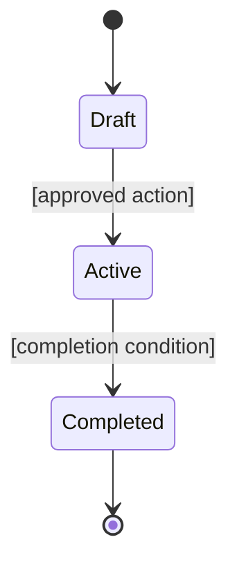

# Template 02 — Product Solution Architecture & Module Design

> Use this template after completing the corresponding Reverse Engineering & Learning document. It records **what our product will build and how the system should be designed**.
>
> Copy this file once per phase, module, sub-feature, or feature. Keep it consistent with the Master Architecture and Product Requirements Document (PRD). Mark undecided items as open decisions instead of guessing.

---

## 0. Document Metadata

| Field | Value |
|---|---|
| Product | [Product name] |
| Architecture area / phase | [Phase] |
| Module | [Module name] |
| Sub-feature | [Sub-feature] |
| Feature | [Feature name] |
| Document version | [0.1] |
| Status | [Draft / In review / Approved / Superseded] |
| Owner | [Owner] |
| Last updated | [YYYY-MM-DD] |
| PRD reference | [Requirement IDs / link] |
| Reverse-engineering reference | [Link to Template 01] |
| Master architecture reference | [Link] |
| Related ADRs | [Decision record links] |

## 1. Purpose and Scope

### 1.1 Problem statement

[The exact user problem this design solves.]

### 1.2 Desired user outcome

[What the user can successfully do after this capability exists.]

### 1.3 Goals

- [Goal 1]
- [Goal 2]

### 1.4 Non-goals

- [Explicitly excluded behaviour]
- [Future capability not included now]

### 1.5 Scope boundary

**Included in this module:**
- [Responsibility]

**Owned by another module:**
- [Responsibility and owning module]

## 2. Approved Product Behaviour

### 2.1 Actors and permissions

| Actor / role | Allowed actions | Disallowed actions | Notes |
|---|---|---|---|
| [Owner] | [Actions] | [Actions] | [Rules] |
| [Admin] | [Actions] | [Actions] | [Rules] |
| [Editor] | [Actions] | [Actions] | [Rules] |
| [Viewer] | [Actions] | [Actions] | [Rules] |

### 2.2 Primary workflow

**Preconditions:** [Required state]

1. [User action]
2. [System validation]
3. [Domain operation]
4. [Persistence / event]
5. [Response and resulting UI state]

**Postconditions:** [What must be true after success]

### 2.3 Alternate workflows

| Scenario | Behaviour |
|---|---|
| [Alternative] | [Expected behaviour] |

### 2.4 Failure workflows

| Failure | System behaviour | User-visible response | Recovery |
|---|---|---|---|
| [Failure] | [Behaviour] | [Response] | [Recovery] |

## 3. Functional Requirements

Give each requirement a stable ID so it can be referenced in implementation tasks and tests.

| Requirement ID | Requirement | Priority | Acceptance criteria | Source |
|---|---|---|---|---|
| FR-001 | [The system shall...] | [Must / should / could] | [Observable test] | [PRD / decision] |

### 3.1 Business rules and invariants

Rules that must always remain true:

| Rule ID | Rule | Enforcement location | Test approach |
|---|---|---|---|
| BR-001 | [Rule / invariant] | [Domain service / database / policy] | [Test] |

### 3.2 State model

| State | Meaning | Allowed next states | Trigger / actor |
|---|---|---|---|
| [State] | [Meaning] | [States] | [Action] |

Add a state diagram if the lifecycle is non-trivial.



Replace this illustrative diagram with the actual states for this feature.

## 4. Domain Design

### 4.1 Domain concepts

| Concept | Type | Responsibility | Owned by this module? |
|---|---|---|---|
| [Concept] | [Entity / value object / domain service / event] | [Purpose] | [Yes / no] |

### 4.2 Entity definitions

For each entity, define identity, attributes, invariants and lifecycle.

#### Entity: `[EntityName]`

| Attribute | Type | Required? | Rules / constraints | Notes |
|---|---|---|---|---|
| id | [UUID / bigint] | Yes | [Immutable / generated] | [Notes] |
| [field] | [Type] | [Yes/no] | [Validation] | [Notes] |

**Identity:** [What makes this entity unique?]

**Lifecycle:** [How it is created, changed, archived or deleted.]

**Invariants:** [Rules that must always hold.]

Repeat for each entity.

### 4.3 Relationships

| From | Relationship | To | Cardinality | Constraints |
|---|---|---|---|---|
| [Entity] | [Relationship] | [Entity] | [1:1 / 1:N / N:M] | [Rules] |

### 4.4 Domain operations

| Operation / command | Input | Preconditions | Result | Side effects |
|---|---|---|---|---|
| [Operation] | [Input] | [Conditions] | [Result] | [Events / records] |

### 4.5 Domain events

| Event | When emitted | Payload essentials | Consumers |
|---|---|---|---|
| [EventName] | [Business fact occurred] | [IDs and required facts] | [Modules] |

Events should describe something that happened, not merely a command that was requested.

## 5. Data Architecture

### 5.1 Persistence model

[Explain which data is stored, which is derived, and why.]

### 5.2 Proposed tables

| Table | Purpose | Primary key | Important foreign keys | Owning module |
|---|---|---|---|---|
| [table_name] | [Purpose] | [PK] | [FKs] | [Module] |

### 5.3 Constraints and indexes

| Table | Constraint / index | Reason |
|---|---|---|
| [Table] | [Unique / FK / check / index] | [Integrity or query need] |

### 5.4 Data ownership

- **Authoritative data owned here:** [List]
- **Data referenced from other modules:** [List]
- **Data not duplicated:** [List]
- **Derived / cached data:** [List and rebuild method]

### 5.5 Data lifecycle and retention

[Deletion, archival, audit, retention, export and privacy rules.]

### 5.6 Transaction boundaries

| Use case | Records affected | Must be atomic? | Consistency requirement |
|---|---|---|---|
| [Use case] | [Records] | [Yes/no] | [Rule] |

## 6. API Design

Use the product's agreed API conventions and version prefix (for example `/api/v1`). Do not create endpoints that duplicate another module's ownership.

| Method | Endpoint | Purpose | Authorization | Request / response schema |
|---|---|---|---|---|
| POST | `/api/v1/[resource]` | [Create] | [Permission] | [Schema link] |
| GET | `/api/v1/[resource]/{id}` | [Read] | [Permission] | [Schema link] |
| PATCH | `/api/v1/[resource]/{id}` | [Update] | [Permission] | [Schema link] |

### 6.1 API contract details

For each endpoint specify:

- Path and query parameters.
- Request schema and validation.
- Response schema.
- HTTP status codes.
- Error codes and error envelope.
- Pagination/filtering/sorting if relevant.
- Idempotency requirements.
- Concurrency/version handling.
- Authorization policy.
- OpenAPI operation reference.

### 6.2 Example request / response

```http
POST /api/v1/[resource]
Content-Type: application/json
Authorization: [authentication mechanism]
```

```json
{
  "exampleField": "replace with the approved request schema"
}
```

```json
{
  "id": "example-id",
  "status": "example-status"
}
```

These are placeholders. Replace them with the approved contract; do not treat this example as a real schema.

## 7. Application and Component Design

### 7.1 Module structure

Describe the responsibility of each layer using the project's agreed architecture.

| Layer | Responsibility | Example components |
|---|---|---|
| API / controller | HTTP mapping, request parsing, response | [Controllers] |
| Application | Use-case orchestration and transaction boundary | [Services / handlers] |
| Domain | Business rules, invariants and domain behaviour | [Entities / policies] |
| Infrastructure | Database, email, maps, storage, external clients | [Adapters / repositories] |

### 7.2 Internal interfaces

| Interface | Caller | Responsibility | Contract |
|---|---|---|---|
| [Interface] | [Module] | [Purpose] | [Input/output] |

### 7.3 External integrations

| Provider / system | Purpose | Data exchanged | Failure / quota / cost considerations |
|---|---|---|---|
| [Provider] | [Purpose] | [Data] | [Considerations] |

Keep provider-specific models behind adapters where practical.

## 8. Security, Authorization and Privacy

### 8.1 Authorization matrix

| Operation | Owner | Admin | Editor | Viewer | Unauthenticated |
|---|---:|---:|---:|---:|---:|
| [Read] | [Allow/deny] | [ ] | [ ] | [ ] | Deny |
| [Create] | [ ] | [ ] | [ ] | [ ] | Deny |
| [Update] | [ ] | [ ] | [ ] | [ ] | Deny |
| [Delete] | [ ] | [ ] | [ ] | [ ] | Deny |

### 8.2 Threats and mitigations

| Threat | Example | Mitigation | Verification |
|---|---|---|---|
| Cross-trip data access | Guess another trip ID | Object-level authorization and scoped queries | Negative API test |
| [Threat] | [Example] | [Mitigation] | [Test] |

### 8.3 Sensitive data

[Identify personal data, location, financial information, booking references and private media. Define minimization, access, retention and deletion.]

## 9. Reliability, Concurrency and Failure Handling

### 9.1 Concurrency

[Describe simultaneous edits, locking/version strategy and conflict response.]

### 9.2 Idempotency

[Identify operations that may be retried and how duplicate effects are prevented.]

### 9.3 Failure and recovery

| Failure mode | Detection | Recovery / retry | User-visible behaviour |
|---|---|---|---|
| [Failure] | [How detected] | [Recovery] | [Response] |

### 9.4 Performance

[Expected query patterns, pagination, indexes, caching needs and measurable performance targets. Mark unknown targets as TBD.]

## 10. Cross-Module Integration

| Related module | Information exchanged | Direction | Contract / event | Coupling risk |
|---|---|---|---|---|
| [Module] | [Data] | [In / out] | [API / event] | [Risk] |

**Upstream dependencies:** [What must exist first]

**Downstream consumers:** [What relies on this module]

**Avoid:** [Direct table access, duplicated business rules, circular dependencies, etc.]

## 11. Testing Strategy

### 11.1 Unit tests

[Domain rules, algorithms, state transitions and invariants.]

### 11.2 Integration tests

[Database constraints, transaction behaviour, external adapters.]

### 11.3 API and authorization tests

[Valid/invalid requests, role matrix, cross-resource access, idempotency.]

### 11.4 End-to-end scenarios

| Test ID | Scenario | Setup | Action | Expected result |
|---|---|---|---|---|
| TC-001 | [Scenario] | [Setup] | [Action] | [Expected] |

### 11.5 Edge-case checklist

- [ ] Empty or missing data.
- [ ] Invalid input and boundary values.
- [ ] Duplicate request.
- [ ] Unauthorized and cross-trip access.
- [ ] Concurrent updates.
- [ ] Network/provider failure.
- [ ] Retry after partial failure.
- [ ] Deletion or archival.
- [ ] Time-zone/date boundary where relevant.
- [ ] Historical data integrity.

## 12. Implementation Readiness and Build Plan

Break work into vertical slices that deliver a working user outcome. Do not split only by technical layer if it leaves every layer unfinished.

| Step | Slice / task | Dependency | Expected behaviour delivered | Tests | Status |
|---|---|---|---|---|---|
| 1 | [Small end-to-end capability] | [Dependency] | [Outcome] | [Tests] | [Not started] |
| 2 | [Next capability] | [Step 1] | [Outcome] | [Tests] | [Not started] |

### Definition of done

- [ ] Requirements and business rules approved.
- [ ] Domain model reviewed.
- [ ] API contract reviewed.
- [ ] Authorization enforced server-side.
- [ ] Database constraints and transaction boundaries defined.
- [ ] Failure and concurrency behaviour defined.
- [ ] Unit, integration and API tests pass.
- [ ] OpenAPI documentation updated.
- [ ] Logs and operational signals added where needed.
- [ ] No unapproved changes to shared architecture.
- [ ] Product acceptance criteria pass.

## 13. Architecture Decisions and Open Questions

### 13.1 Decision log

| Decision ID | Decision | Alternatives considered | Reason | Date | Status |
|---|---|---|---|---|---|
| ADR-[NNN] | [Decision] | [Alternatives] | [Trade-off] | [Date] | [Proposed / accepted] |

### 13.2 Open questions

| Question | Why it matters | Owner / decision maker | Blocks implementation? |
|---|---|---|---|
| [Question] | [Impact] | [Owner] | [Yes / no] |

### 13.3 Risks

| Risk | Probability | Impact | Mitigation |
|---|---|---|---|
| [Risk] | [Low/medium/high] | [Low/medium/high] | [Mitigation] |

## 14. Final Architecture Review

**Chosen solution:** [Summary]

**Why this is the right MVP solution:** [Reasoning]

**What is intentionally deferred:** [Future work]

**How this design can evolve:** [Extension path without premature complexity]

**Review status:** [Draft / approved / needs changes]

### Approval checklist

- [ ] Solves the approved user problem.
- [ ] Consistent with PRD and reverse-engineering findings.
- [ ] Clear module ownership and boundaries.
- [ ] Domain model and invariants are explicit.
- [ ] API and data contracts are explicit.
- [ ] Security and privacy are designed.
- [ ] Transaction and concurrency rules are clear.
- [ ] Dependencies are understood.
- [ ] Tests cover expected and failure behaviour.
- [ ] Master architecture has been updated.
- [ ] No unresolved blocking decision remains.

---

## Reusable AI Prompt — Product Architect and Design Reviewer

You are the product architect for my group travel-planning SaaS.

Use this architecture template to turn an approved reverse-engineering investigation and PRD requirements into a technically coherent design for **[phase / module / sub-feature / feature]**.

Context documents:
- Product PRD: [link]
- Reverse-engineering and learning document: [link]
- Master architecture: [link]
- Related module designs / ADRs: [links]

Rules:

1. Treat the PRD and approved product decisions as requirements. Do not silently change product scope.
2. Use the reverse-engineering document as evidence about market behaviour, not as proof of the competitor's internal implementation.
3. Clearly distinguish approved decisions, recommendations, assumptions and unresolved questions.
4. Define domain responsibilities and data ownership before proposing tables or endpoints.
5. Explain entities, relationships, invariants, state transitions and business operations.
6. Design APIs, authorization, persistence, transaction boundaries, concurrency, idempotency and failure handling.
7. Check dependencies and compatibility with the master architecture and other module contracts.
8. Prefer a modular monolith with clear boundaries unless there is a demonstrated reason for another deployment model.
9. Do not introduce microservices, queues, caches, distributed locks or complex patterns merely because they are available.
10. Compare alternatives and explain trade-offs before recommending a design.
11. Include negative cases, edge cases, security and privacy concerns, and testable acceptance criteria.
12. Do not write implementation code until I explicitly approve the design and request implementation.
13. If a decision is missing, ask me one focused question at a time when it materially affects the design. Otherwise mark it as an open decision.

At the end, provide a design review: identify contradictions, missing requirements, risky assumptions, cross-module impacts and whether the module is ready for implementation by a coding AI.
